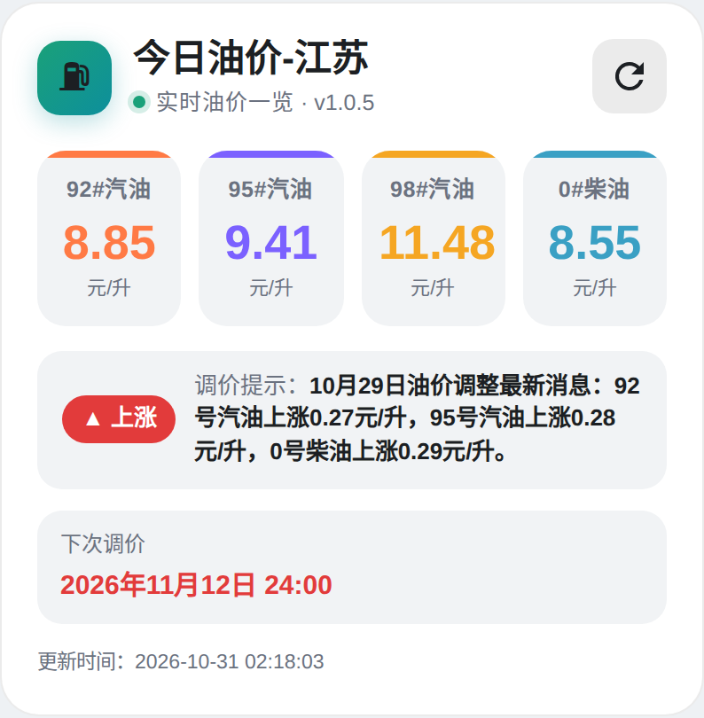
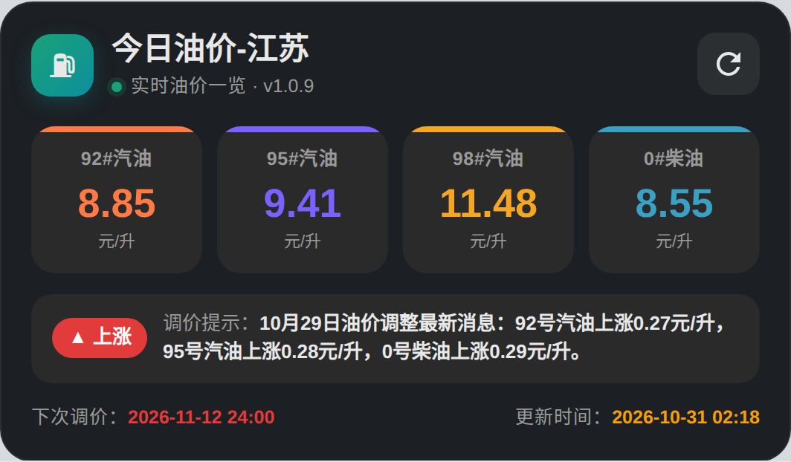

# 中国油价一览卡片（China Gas Price Card）

Home Assistant 自定义 Lovelace 卡片，把「油捷 / you_jie」等油价集成里的汽油、柴油价格、调价趋势与下次调价时间，整理成一张精美的一览表。

> ⚠️ **前置条件**：本卡片只是**展示层**，本身不获取数据。使用前请先在 Home Assistant 中装好油价集成（实体形如 `sensor.you_jie_<地区>_gas92`）。

本卡片的卡片骨架参考自 [hxf14789/State-Grid-Electricity-Card](https://github.com/hxf14789/State-Grid-Electricity-Card)：单文件 Lovelace 卡片 + shadow DOM + 跟随 HA 主题变量，无构建步骤。

## 效果图

| 浅色主题 | 深色主题 |
|---|---|
|  |  |

> 移动端效果见 `card-mobile.png`（与桌面端版式一致，四档油价同样一行 4 列），整页对比见 `preview-full.png`。

## 功能

- **四宫格油价**：92# / 95# / 98# 汽油 + 0# 柴油，大字号展示「元/升」
- **全端统一版式**：手机、平板、电脑都是**同一套布局**，四档油价始终**一行 4 列**，不会在窄屏折成 2×2；字号与内边距用容器查询按卡片自身宽度平滑缩放，小屏也放得下、不越界
- **调价趋势**：根据 `trend` 实体自动着色（**涨=红、跌=绿、搁浅=蓝**，符合国内习惯）并显示箭头
- **下次调价**：底部信息条与「更新时间」在同一行、两端分布；两个时间统一为 `YYYY-MM-DD HH:mm` 格式，「下次调价」红字加粗、「更新时间」橙字加粗，重点分明（`time` 与 `tips`）
- **一键刷新**：点击右上角刷新图标（矢量 SVG，任意端同尺寸、绕几何中心旋转不偏移）调用 `button.<key>_refresh` 立即更新
- **标题格式**：固定为「今日油价-地区」，地区名取自 `sensor.<key>_friendly_name` 的状态值，例如值为 `油价-江苏` 时标题显示 `今日油价-江苏`（自动剥离重复的「油价」「今日油价」前缀与分隔符）
- **深浅色自适应**：跟随 Home Assistant 主题（读取 `--ha-card-background` 等主题变量）
- 实体缺失时优雅显示 `--`，不会报错

## 安装

### HACS（推荐）

1. HACS → 前端 → 右上角 ⋮ → **自定义存储库**
2. 填入本仓库地址，类别选择 **仪表盘**
3. 搜索「China Gas Price Card」→ 下载
4. 刷新页面（必要时重启 HA 或强制刷新浏览器缓存）

### 手动安装

1. 下载 `dist/gas-price-card.js`，放到 `/config/www/`
2. 设置 → 仪表盘 → ⋮ → 资源 → 添加 `/local/gas-price-card.js`，类型选 **JavaScript 模块**

## 配置

先在 **开发者工具 → 状态** 里找到你的油价实体，确认前缀。例如 `sensor.you_jie_jiang_su_gas92`，前缀就是 `you_jie_jiang_su`。

```yaml
type: custom:gas-price-card
key: you_jie_jiang_su      # 实体前缀
name: 江苏                 # 标题（可选，默认用集成里的地区名）
```

### 实体命名不统一？用 entities 逐条指定

```yaml
type: custom:gas-price-card
key: my_oil               # 仅作标识，不参与实体匹配
name: 江苏
entities:
  gas92: sensor.you_jie_jiang_su_gas92
  gas95: sensor.you_jie_jiang_su_gas95
  gas98: sensor.you_jie_jiang_su_gas98
  die0:  sensor.you_jie_jiang_su_die0
  trend: sensor.you_jie_jiang_su_trend
  time:  sensor.you_jie_jiang_su_time
  tips:  sensor.you_jie_jiang_su_tips
  update_time: sensor.you_jie_jiang_su_update_time
  friendly_name: sensor.you_jie_jiang_su_friendly_name
refresh_entity: button.you_jie_jiang_su_refresh
```

`entities` 里没写的项，仍按 `sensor.<key>_<后缀>` 拼接。

## 参数说明

| 参数 | 类型 | 必填 | 说明 |
|---|---|---|---|
| `key` | string | 是 | 实体前缀，卡片据此拼出 `sensor.<key>_gas92` 等 |
| `name` | string | 否 | 地区名兜底值；正常情况地区名取自 `sensor.<key>_friendly_name` |
| `entities` | map | 否 | 逐条覆盖实体 ID（键见上表） |
| `refresh_entity` | string | 否 | 刷新按钮对应的实体，默认 `button.<key>_refresh` |

## 适配的实体（默认后缀）

| 后缀 | 含义 |
|---|---|
| `gas92` / `gas95` / `gas98` | 92/95/98# 汽油价格 |
| `die0` | 0# 柴油价格 |
| `trend` | 油价趋势（涨/跌/搁浅） |
| `time` | 下次调价倒计时 |
| `tips` | 调价提示 |
| `update_time` | 更新时间 |
| `friendly_name` | 地区名称 |

## 仓库结构

```
gas-price-card/
├── hacs.json                      # HACS 清单（声明 JS 文件名、最低版本）
├── info.md                        # HACS 商店简介
├── README.md                      # 本文档（HACS 渲染）
├── src/gas-price-card.js          # 卡片源码
├── dist/gas-price-card.js         # 构建产物（HACS 实际加载）
├── preview.html                   # 浏览器预览（含示例数据，可离线打开）
└── .github/workflows/release.yml  # 打 tag 自动发 Release
```

## 许可

AGPL-3.0
